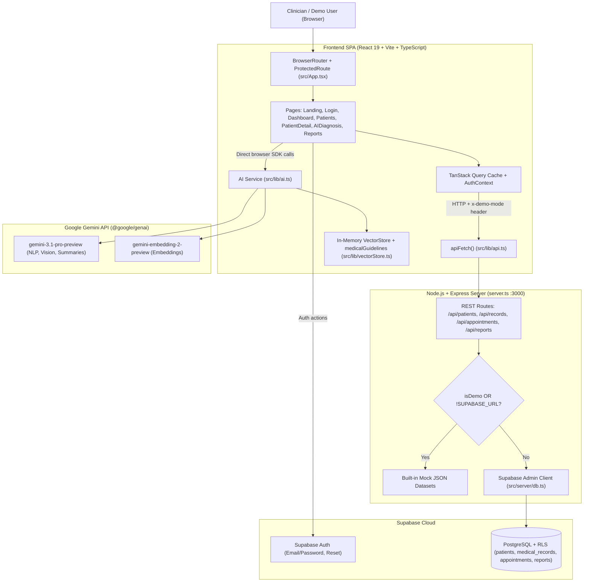

# DermRecord AI — Complete Interview-Prep Handbook

> **Purpose of this handbook:** Everything in this document is derived directly from the actual source code in this repository. Where a motivation, deployment target, or historical step is inferred rather than explicitly written in code, it is clearly marked **`(assumption)`**.

---

# 1. Project Overview

## What Problem Does DermRecord AI Solve?
Dermatologists and clinical practitioners spend a huge amount of time typing unstructured consultation notes, manually tracking longitudinal treatment progress across visits, cross-referencing clinical guidelines, and rewriting patient histories into formal reports. **DermRecord AI** is a full-stack dermatology Electronic Health Record (EHR) and AI clinical assistant that bridges the gap between messy, real-time clinical notes (and lesion photos) and structured, evidence-grounded medical documentation.

## Target Users
- **Dermatologists & Clinical Practitioners:** Use the protected clinical suite (`/dashboard`, `/patients`, `/patients/:id`, `/ai-diagnosis`, `/reports`) to register patients, log consultations, run AI symptom extraction + RAG guideline retrieval, capture/analyze skin lesion photos, and generate formal clinical reports.
- **Recruiters / Evaluators / Demo Viewers:** Can click **"Explore Demo"** or **"Watch Demo"** on `LandingPage.tsx` to bypass Supabase login (`demoMode = true` in `AuthContext.tsx`) and immediately test the entire application using built-in mock patient/record/report data from `server.ts` while still exercising live Gemini AI features (if `GEMINI_API_KEY` is configured).

## Core Features (Verified in Code)
1. **Landing & Authentication Suite (`LandingPage.tsx`, `Login.tsx`, `UpdatePassword.tsx`, `AuthContext.tsx`):**
   - Marketing landing page with animated Framer Motion (`motion/react`) hero cards, capability cards, and a one-click **Demo Mode** button.
   - Email/password sign-in, practitioner registration, and password reset flow backed by Supabase Auth.
2. **Practice Dashboard (`Dashboard.tsx`):**
   - Summary KPI cards (Total Patients, Upcoming Appointments, AI Extractions status, System Status).
   - Cumulative 6-month **Patient Growth** line chart rendered with Recharts (`LineChart`, `ResponsiveContainer`).
   - Upcoming Appointments list and Recent Patients quick-access table.
3. **Patient Management & Registration (`Patients.tsx`, `RegisterPatient.tsx`):**
   - Searchable patient directory with confirmation-dialog deletion.
   - Multi-field intake form (`RegisterPatient.tsx`) that creates both a `patients` record (`POST /api/patients`) and an initial `medical_records` entry (`POST /api/records`).
4. **Patient Detail & Consultation Workspace (`PatientDetail.tsx`):**
   - **Profile Tab:** View and edit patient demographics (`PUT /api/patients/:id`) with automatic age calculation.
   - **Consultation Tab:**
     - **Auto-generate Draft** (`generateFollowUpNotes`): Drafts a plain-text follow-up note from the patient's profile and past records.
     - **Improve Notes** (`improveClinicalNotes`): Polishes rough doctor notes into structured medical prose without inventing facts.
     - **Analyze with AI** (`extractClinicalData` → chains automatically into `retrieveRagContext`): Extracts structured JSON (symptoms, duration, severity, body parts, possible conditions, risk level, recommended tests) and queries an in-memory vector store of dermatology guidelines.
     - **AI Skin Condition Summary** (`generatePatientSummary`): Synthesizes longitudinal history into a concise summary.
     - **Save / Update Record:** Persists notes and `structured_data` JSONB via `POST /api/records` or `PUT /api/records/:id`.
   - **Treatment Progress Tab:** Logs structured status (`Ongoing`, `Improving`, `Resolved`, `Worsening`), severity (`Mild`, `Moderate`, `Severe`), treatment given, and next steps into `medical_records`.
   - **Medical History Tab:** Chronological timeline of past consultations and treatment progress notes with edit and delete actions.
5. **Multimodal AI Skin Diagnosis (`AIDiagnosis.tsx`):**
   - Accepts either an uploaded skin/dermoscopy image (`FileReader.readAsDataURL`), a **live camera capture** (`navigator.mediaDevices.getUserMedia` + `<canvas>`), clinical text observations, or both.
   - Calls `analyzeSkinCondition` (`gemini-3.1-pro-preview`) and renders structured possible conditions, color-coded severity badge, narrative analysis, and recommended next steps.
6. **Clinical Reports (`Reports.tsx`):**
   - Formal report builder (`POST /api/reports`) with a Recent Reports sidebar (`GET /api/reports`).
   - **AI Auto-fill from Records** (`handleAutoFill` → `generateReportDetails`): Fetches the selected patient's profile and medical records in parallel and auto-populates Diagnosis Notes, Examination Findings, and Treatment/Prescription Notes.

## 30-Second Pitch (Spoken Script)
> "I built **DermRecord AI**, a full-stack dermatology EHR and clinical intelligence platform built with React 19, TypeScript, Express, Supabase, and the Google Gemini SDK. Doctors can manage patient profiles and longitudinal consultation histories, capture or upload skin lesion images for multimodal AI triage, and automatically extract structured symptoms from messy notes. What makes it especially useful is its Retrieval-Augmented Generation pipeline—it embeds dermatology clinical guidelines into a vector store using Gemini embeddings and grounds diagnostic reasoning in verified clinical references, cutting down documentation time while keeping outputs structured."

## 2-Minute Explanation (Spoken Script)
> "DermRecord AI addresses a major bottleneck in clinical dermatology: practitioners spend excessive time turning rough visit observations into structured EHR entries, summarizing multi-visit histories, and writing formal reports.
>
> On the frontend, I built a React 19 and TypeScript SPA styled with Tailwind CSS v4 and shadcn/ui components built on Base UI, using React Router for navigation and TanStack Query for server-state caching. Authentication is handled via Supabase Auth, alongside a built-in Demo Mode stored in `localStorage` that attaches an `x-demo-mode` header via a custom `apiFetch` wrapper so evaluators can explore every screen without credentials.
>
> On the backend, an Express server in `server.ts` serves REST endpoints for patients, medical records, appointments, and reports, connecting to Supabase PostgreSQL via `@supabase/supabase-js`—and gracefully falling back to mock clinical datasets when running in Demo Mode or before Supabase is configured.
>
> For the AI layer in `src/lib/ai.ts`, I used the `@google/genai` SDK with `gemini-3.1-pro-preview` and `gemini-embedding-2-preview`. Whenever a clinician clicks 'Analyze with AI' on a consultation note, Gemini extracts strict JSON via `responseSchema`—capturing symptoms, anatomical sites, severity, risk level, and recommended tests. Those extracted symptoms automatically trigger `retrieveRagContext`, which lazily embeds nine dermatology clinical guidelines into an in-memory `VectorStore` and performs cosine similarity search to return the top two matching guidelines. Clinicians can also capture live webcam photos on the AI Diagnosis page for multimodal image-plus-text assessment, auto-draft follow-up notes from patient history, and auto-fill formal reports. All of this compiles into a single production bundle via Vite and esbuild, served by Node on port 3000."

---

# 2. End-to-End Architecture

## Architectural Layers

| Layer | Responsibility | Key Files |
| :--- | :--- | :--- |
| **1. UI / Presentation Layer** | Public landing page, auth views, responsive sidebar shell (`AppLayout`), forms, charts, camera capture, and AI result cards. | `src/App.tsx`, `src/pages/*.tsx`, `components/ui/*.tsx`, `src/index.css` |
| **2. Client State & Caching Layer** | Auth session & demo-mode state via React Context (`AuthContext`), local component state via `useState`/`useRef`, and server-data caching/invalidation via TanStack Query (`QueryClient`). | `src/lib/AuthContext.tsx`, `src/App.tsx`, `src/pages/*.tsx` |
| **3. Client API & AI Service Layer** | `apiFetch` injects `x-demo-mode: true` when Demo Mode is active. `src/lib/ai.ts` runs all active Gemini API calls (`generateContent`, `embedContent`) and coordinates the in-memory `VectorStore` RAG search. | `src/lib/api.ts`, `src/lib/ai.ts`, `src/lib/vectorStore.ts`, `src/lib/medicalKnowledge.ts`, `src/lib/supabase.ts` |
| **4. Backend API & Static Server Layer** | Express server (`server.ts`) on port `3000` handling `/api/*` CRUD routes, demo/unconfigured mock fallbacks, Vite dev middleware in development, and static `dist/` serving in production. | `server.ts`, `src/server/db.ts`, `(unused legacy: src/server/ai.ts)` |
| **5. Persistence & Auth Layer** | Supabase PostgreSQL (`patients`, `medical_records`, `appointments`, `reports`) with RLS policies, plus Supabase Auth (JWT sessions, password reset). | `schema.sql`, `supabase_security_fix.sql`, `seed.ts` |
| **6. Build & Deployment Layer** | Vite bundles the React frontend to `dist/`, `esbuild` bundles `server.ts` to `dist/server.cjs`, and `npm start` runs `node dist/server.cjs`. | `package.json`, `vite.config.ts`, `tsconfig.json` |

## System Architecture Diagram (Mermaid)



## Full Request Walkthrough: "Analyze with AI" in `PatientDetail.tsx`
Let's trace one complete user interaction from button click to final screen update, naming the exact files and functions:

1. **User Click (`src/pages/PatientDetail.tsx`):**
   - The clinician types clinical notes into the `<Textarea>` (bound to `notes` state) inside the `Consultation` tab and clicks **"Analyze with AI"** (lines 434–441).
   - The button's `onClick` handler invokes `extractMutation.mutate(notes)`.
2. **Structured Extraction Call (`src/pages/PatientDetail.tsx` → `src/lib/ai.ts`):**
   - `extractMutation.mutationFn` (line 92) calls `extractClinicalData(clinicalNotes)` in `src/lib/ai.ts` (line 38).
   - `extractClinicalData` calls `ai.models.generateContent` using model `"gemini-3.1-pro-preview"` with `responseMimeType: "application/json"` and a strict `responseSchema` requiring `symptoms`, `duration`, `severity`, `body_parts`, `possible_conditions`, `risk_level`, and `recommended_tests`.
   - It strips any markdown code fences (`replace(/```json/g, "")...`), parses the JSON with `JSON.parse`, and returns the structured object.
3. **State Update & Chained RAG Trigger (`src/pages/PatientDetail.tsx`):**
   - Inside `extractMutation.onSuccess` (lines 95–100), `setExtractedData(data)` updates React state so the **AI Insight** card immediately renders the symptoms badges, duration, severity, possible conditions, and recommended tests.
   - If `data.symptoms?.length > 0`, it automatically triggers `ragMutation.mutate(data.symptoms.join(", "))`.
4. **Vector Store Initialization & Cosine Search (`src/lib/ai.ts` → `src/lib/vectorStore.ts` & `src/lib/medicalKnowledge.ts`):**
   - `ragMutation.mutationFn` (line 128) calls `retrieveRagContext(query)` in `src/lib/ai.ts` (line 85).
   - `retrieveRagContext` first awaits `initVectorStore()` (line 11). If `isVectorStoreInitialized` is `false`, it loops over the 9 guideline strings in `medicalGuidelines` (`src/lib/medicalKnowledge.ts`), embeds each via `ai.models.embedContent({ model: "gemini-embedding-2-preview", contents: text })`, and adds them to `medicalVectorStore` (`VectorStore.addDocument`).
   - Next, it embeds the patient's symptoms `query` with `gemini-embedding-2-preview` and calls `medicalVectorStore.search(queryEmbedding, 2)` in `src/lib/vectorStore.ts` (line 30), which computes exact `cosineSimilarity` across all stored documents, sorts descending, and returns the top 2 matches.
   - If embedding fails at any point, the `catch` block calls `generateRagContextFallback(query)` (line 71) to ask `gemini-3.1-pro-preview` for a brief factual literature summary instead.
5. **Final UI Render (`src/pages/PatientDetail.tsx`):**
   - `ragMutation.onSuccess` calls `setRagContext(data)` (line 133).
   - The **RAG Knowledge Retrieval** card (lines 529–547) updates from `"Searching medical literature..."` to displaying the formatted guidelines and similarity percentages.
   - Later, when the clinician clicks **"Save Record"**, `saveRecordMutation` calls `apiFetch("/api/records", { method: "POST", ... })` (`src/lib/api.ts`) → handled by `app.post("/api/records")` in `server.ts` (line 174) → writes to Supabase `medical_records` (or returns mock JSON in Demo Mode) → invalidates `["records", id]` in TanStack Query.

---

# 3. Tech Stack: Why and How

Below is every technology, library, framework, and API found in `package.json` and project imports.

### Core Language & Build Tooling

#### 1. TypeScript (`~5.8.2`)
- **What it is:** A statically typed superset of JavaScript that compiles/type-checks before runtime.
- **Why chosen & alternatives:** Prevents shape mismatches in complex clinical payloads, API responses, and React props (`AuthContextType`, `Document` in `vectorStore.ts`). Alternative: plain JavaScript with JSDoc.
- **How it is used:** All frontend and backend source files use `.ts`/`.tsx` (`tsconfig.json`, `npm run lint` runs `tsc --noEmit`).
- **What breaks if removed:** Type checking (`npm run lint`) fails and `.tsx`/`.ts` type annotations cannot compile without stripping types.

#### 2. Vite (`^6.2.0`) & `@vitejs/plugin-react` (`^5.0.4`)
- **What it is:** A fast frontend dev server (ES modules) and Rollup-based production bundler.
- **Why chosen & alternatives:** Instant startup and clean integration into Express via `createServer({ server: { middlewareMode: true } })` in `server.ts`. Alternatives: Next.js, Webpack, Parcel.
- **How it is used:** `vite.config.ts` configures React, Tailwind v4, path alias `@`, and `define` env injection; `server.ts` (line 276) mounts `vite.middlewares` in dev; `npm run build` runs `vite build`.
- **What breaks if removed:** Frontend JSX/TSX cannot be bundled for production (`dist/`) or served in development middleware mode.

#### 3. `tsx` (`^4.21.0`) & `esbuild` (`^0.28.1`)
- **What they are:** `tsx` executes TypeScript files directly in Node.js; `esbuild` is an ultra-fast JS/TS bundler.
- **Why chosen & alternatives:** Allows running `server.ts` and `seed.ts` without a separate `tsc` build step in dev (`npm run dev` runs `tsx server.ts`), and bundles `server.ts` into a single CommonJS file (`dist/server.cjs`) for production (`npm run build`). Alternatives: `ts-node` + `tsc`, or `nodemon`.
- **How they are used:** `package.json` scripts `"dev": "tsx server.ts"` and `"build": "vite build && esbuild server.ts --bundle --platform=node --format=cjs --packages=external --sourcemap --outfile=dist/server.cjs"`.
- **What breaks if removed:** `npm run dev` fails immediately without `tsx`; `npm run build` fails to produce `dist/server.cjs` without `esbuild`.

---

### Frontend Framework, Routing & State

#### 4. React (`^19.0.0`) & React DOM (`^19.0.0`)
- **What it is:** Component-based UI library for building single-page applications.
- **Why chosen & alternatives:** Rich ecosystem, hooks (`useState`, `useEffect`, `useRef`, `useContext`), and seamless compatibility with TanStack Query and shadcn/Base UI. Alternatives: Vue 3, Svelte, Angular.
- **How it is used:** Bootstrapped in `src/main.tsx` with `StrictMode` and `createRoot`; powers every page in `src/pages/` and layout in `src/App.tsx`.
- **What breaks if removed:** Entire frontend UI ceases to exist.

#### 5. React Router DOM (`^7.14.0`)
- **What it is:** Client-side declarative routing library for React SPAs.
- **Why chosen & alternatives:** Standard SPA routing with nested layouts (`AppLayout`), dynamic params (`/patients/:id`), and route guards (`ProtectedRoute`). Alternatives: TanStack Router, Wouter.
- **How it is used:** `src/App.tsx` wraps routes in `<BrowserRouter>`, `<Routes>`, `<Route>`; `ProtectedRoute` redirects unauthenticated/non-demo users to `/`; `useNavigate`, `useParams`, `useLocation`, and `<Link>` are used across pages.
- **What breaks if removed:** Multi-page navigation (`/dashboard`, `/patients/:id`, `/ai-diagnosis`, `/reports`, `/login`) and protected route gating break completely.

#### 6. TanStack Query (`@tanstack/react-query` `^5.97.0`)
- **What it is:** Asynchronous server-state management, caching, and mutation library for React.
- **Why chosen & alternatives:** Eliminates manual `useEffect` loading/error boilerplate and automatically refreshes views via `queryClient.invalidateQueries` after mutations (creating/editing/deleting patients, records, or reports). Alternatives: Redux Toolkit + RTK Query, SWR, raw `fetch` + `useEffect`.
- **How it is used:** `QueryClientProvider` in `src/App.tsx`; `useQuery` and `useMutation` in `Dashboard.tsx`, `Patients.tsx`, `PatientDetail.tsx`, `RegisterPatient.tsx`, `AIDiagnosis.tsx`, and `Reports.tsx`.
- **What breaks if removed:** Every data fetch and mutation across all clinical pages fails unless rewritten with manual state and `useEffect`.

---

### Styling, Design System & UI Primitives

#### 7. Tailwind CSS (`^4.1.14`), `@tailwindcss/vite` (`^4.1.14`), `autoprefixer` (`^10.4.21`), & `tw-animate-css` (`^1.4.0`)
- **What they are:** Utility-first CSS framework (v4 with Vite plugin) plus CSS animation utilities.
- **Why chosen & alternatives:** Rapid, consistent responsive styling without writing custom CSS files for every component. Alternatives: CSS Modules, Styled Components, MUI.
- **How it is used:** Imported via `@import "tailwindcss";` and `@import "tw-animate-css";` in `src/index.css`; `@tailwindcss/vite` is registered in `vite.config.ts`.
- **What breaks if removed:** All utility classes (`flex`, `grid`, colors, spacing, responsive breakpoints) stop applying, collapsing the entire layout.

#### 8. shadcn/ui (`shadcn` `^4.2.0`), `@base-ui/react` (`^1.3.0`), `class-variance-authority` (`^0.7.1`), `clsx` (`^2.1.1`), & `tailwind-merge` (`^3.5.0`)
- **What they are:** Copy-pasteable accessible UI components (`components/ui/*`) configured via `components.json` (`"style": "base-nova"`). Under the hood, components like `Button`, `Dialog`, `Select`, `Tabs`, `Input`, and `Badge` wrap `@base-ui/react` primitives and merge Tailwind classes with `cva`, `clsx`, and `tailwind-merge` (`cn()` in `lib/utils.ts`).
- **Why chosen & alternatives:** Gives full ownership of component code inside `components/ui/` with built-in keyboard/ARIA accessibility. Alternatives: Radix UI directly, Ant Design, Chakra UI, Headless UI.
- **How they are used:** `components/ui/*.tsx` import `@base-ui/react/*`, `cva`, and `cn` from `@/lib/utils`; imported across all pages via `@/components/ui/*`.
- **What breaks if removed:** Every `Button`, `Card`, `Dialog`, `Select`, `Tabs`, `Table`, `Input`, `Textarea`, `Label`, and `Badge` across the app fails to compile.
- *(Note on unused UI package)*: `@radix-ui/react-slot` (`^1.2.4`) and `@fontsource-variable/geist` (`^5.2.8`) are listed in `package.json`, but `components/ui/*` uses `@base-ui/react` instead of Radix Slot, and `src/index.css` loads `Cormorant Garamond` and `Inter` from Google Fonts rather than Geist.

#### 9. `lucide-react` (`^0.546.0`)
- **What it is:** Lightweight SVG icon library for React.
- **Why chosen & alternatives:** Clean medical/UI iconography (`Activity`, `BrainCircuit`, `Stethoscope`, `Microscope`, `Camera`, etc.) with tree-shaking. Alternatives: Heroicons, React Icons, Phosphor Icons.
- **How it is used:** Imported in `App.tsx`, all `src/pages/*.tsx`, and `components/ui/dialog.tsx` / `select.tsx`.
- **What breaks if removed:** All navigation, button, and card icons fail to render/compile.

#### 10. `motion` (`^12.23.24` — Framer Motion)
- **What it is:** Declarative animation library for React.
- **Why chosen & alternatives:** Powers smooth entrance transitions (`initial`/`animate`/`whileInView`), staggered feature cards, and floating hero cards on `LandingPage.tsx`. Alternatives: CSS keyframes, React Spring, GSAP.
- **How it is used:** `import { motion } from "motion/react"` in `src/pages/LandingPage.tsx` (lines 17, 74–166, 186–222, 263–298).
- **What breaks if removed:** `LandingPage.tsx` fails to compile unless `<motion.div>` elements are replaced with standard `<div>`s.

#### 11. `recharts` (`^3.8.1`)
- **What it is:** Composable React charting library built on D3 primitives.
- **Why chosen & alternatives:** Declarative `<ResponsiveContainer>`, `<LineChart>`, `<Line>`, `<Tooltip>` components fit cleanly inside shadcn `<Card>`s. Alternatives: Chart.js, Victory, Nivo.
- **How it is used:** `src/pages/Dashboard.tsx` (lines 5, 132–144) renders the 6-month cumulative **Patient Growth** chart.
- **What breaks if removed:** `Dashboard.tsx` fails to compile and the Patient Growth visualization disappears.

---

### AI, Backend, Database & Utilities

#### 12. Google GenAI SDK (`@google/genai` `^1.29.0`)
- **What it is:** Official Google Gemini TypeScript SDK for generative models, multimodal inputs, structured JSON outputs, and text embeddings.
- **Why chosen & alternatives:** Native support for `gemini-3.1-pro-preview` (multimodal text + inline image base64 + `responseSchema` strict JSON) and `gemini-embedding-2-preview` in a single SDK. Alternatives: OpenAI SDK, Anthropic SDK, Vercel AI SDK, LangChain.js.
- **How it is used:** `src/lib/ai.ts` initializes `new GoogleGenAI({ apiKey: process.env.GEMINI_API_KEY })` and exports 8 functions (`extractClinicalData`, `generateRagContextFallback`, `retrieveRagContext`, `generateReport`, `improveClinicalNotes`, `generatePatientSummary`, `generateReportDetails`, `generateFollowUpNotes`, `analyzeSkinCondition`). Also present in legacy `src/server/ai.ts`.
- **What breaks if removed:** Every AI feature (symptom extraction, RAG embeddings, note improvement, follow-up drafts, patient summaries, report auto-fill, and skin image diagnosis) fails.

#### 13. Express (`^4.22.1`) & `cors` (`^2.8.6`)
- **What they are:** Minimalist Node.js HTTP server framework and Cross-Origin Resource Sharing middleware.
- **Why chosen & alternatives:** Lightweight REST API layer that can embed Vite in dev (`vite.middlewares`) and serve static builds in production (`express.static`) on one port (`3000`). Alternatives: Fastify, Hono, Next.js API routes.
- **How they are used:** `server.ts` creates `app = express()`, applies `cors()` and `express.json()`, defines `/api/*` routes, and listens on port `3000`.
- **What breaks if removed:** All `/api/*` endpoints stop serving data, breaking Dashboard, Patients, PatientDetail, RegisterPatient, and Reports, and production static serving stops.

#### 14. Supabase JS (`@supabase/supabase-js` `^2.103.0`) & PostgreSQL + `pgvector`
- **What it is:** Backend-as-a-Service providing PostgreSQL, Auth, and Row Level Security (RLS).
- **Why chosen & alternatives:** Combines relational EHR tables (`patients`, `medical_records`, `appointments`, `reports`), built-in user authentication (`auth.users`, password reset), and optional `pgvector` support (`schema.sql`) in one managed platform. Alternatives: Firebase (`Firestore` + Auth), Neon/Cloud SQL + Auth0, Prisma + Express Auth.
- **How it is used:**
  - **Client (`src/lib/supabase.ts`):** Uses `SUPABASE_ANON_KEY` for Auth in `AuthContext.tsx`, `Login.tsx`, and `UpdatePassword.tsx`.
  - **Server (`src/server/db.ts`):** Uses `SUPABASE_SERVICE_ROLE_KEY` for CRUD queries in `server.ts` and `seed.ts`.
- **What breaks if removed:** Live user authentication (`Login.tsx`, `UpdatePassword.tsx`) breaks, and persistent database storage fails (forcing the app into Demo/Mock mode only).

#### 15. `dotenv` (`^17.2.3`)
- **What it is:** Loads `.env` environment variables into `process.env` in Node.js.
- **Why chosen & alternatives:** Standard Node.js local config loader (Node 20+ also supports `--env-file`, which is an alternative).
- **How it is used:** Imported and called in `src/server/db.ts` (line 4) and `src/server/ai.ts` (line 4).
- **What breaks if removed:** Local `.env` variables (`SUPABASE_URL`, `SUPABASE_SERVICE_ROLE_KEY`) would not load automatically in `server.ts` or `seed.ts` unless exported in the shell.

#### 16. Unused / Scaffolded Dependencies in `package.json`
Honesty check—these exist in `package.json` (and `multer` is imported in `server.ts`), so interviewers may ask about them:
- **`multer` (`^2.1.1`):** Imported on line 5 of `server.ts`, intended for multipart file uploads (e.g., PDF/image upload in `RegisterPatient.tsx`), **not yet wired to an upload route**.
- **`pdf-parse` (`^2.4.5`):** Installed for parsing uploaded PDF medical reports, **not currently imported anywhere**.
- **`zod` (`^4.3.6`):** Installed for schema validation, **not currently imported anywhere**.
- **`@radix-ui/react-slot` & `@fontsource-variable/geist`:** Leftover template/shadcn dependencies; the UI components actually use `@base-ui/react` and Google Fonts (`Cormorant Garamond` + `Inter`).

---

# 4. Folder and File Structure

```text
/
├── .env.example                 # Template documenting required Gemini, App URL, and Supabase env vars
├── components.json              # shadcn/ui CLI config ("base-nova" style, paths, Lucide icons)
├── index.html                   # HTML entry point loading /src/main.tsx
├── metadata.json                # App metadata ("DermRecord AI") and camera frame permission
├── package.json                 # Dependencies and scripts (dev, build, start, lint)
├── PROJECT_REPORT.md            # High-level project summary documentation
├── README.md                    # Setup and feature overview documentation
├── schema.sql                   # Initial PostgreSQL + pgvector schema (users, patients, medical_records, diagnoses, appointments, ai_logs, documents, document_chunks)
├── supabase_security_fix.sql    # Hardened Supabase migration (adds reports table, record_type, RLS policies, extensions schema)
├── seed.ts                      # Standalone script to seed sample patients ("John Doe", "Jane Smith") into Supabase
├── server.ts                    # Express REST API server + Vite dev middleware / production static server on port 3000
├── tsconfig.json                # TypeScript config (ES2022, bundler resolution, @/* path alias)
├── vite.config.ts               # Vite config (React, Tailwind v4, env define injection, HMR toggle)
├── components/
│   └── ui/                      # Reusable shadcn/ui components built on @base-ui/react (badge, button, card, dialog, input, label, select, table, tabs, textarea)
├── lib/
│   └── utils.ts                 # cn() helper combining clsx and tailwind-merge
└── src/
    ├── App.tsx                  # Root router, QueryClientProvider, AuthProvider, ProtectedRoute, and responsive AppLayout sidebar
    ├── index.css                # Google Fonts (Cormorant Garamond, Inter), Tailwind v4 import, shadcn CSS variables
    ├── main.tsx                 # React 19 DOM entry point
    ├── lib/
    │   ├── AuthContext.tsx      # Manages Supabase auth session, signOut(), and localStorage-persisted demoMode
    │   ├── ai.ts                # Active client-side Gemini AI service + lazy in-memory RAG pipeline
    │   ├── api.ts               # apiFetch() wrapper injecting 'x-demo-mode: true' header when demoMode is active
    │   ├── medicalKnowledge.ts  # Array of 9 curated dermatology clinical guideline strings for RAG
    │   ├── supabase.ts          # Browser Supabase client (uses SUPABASE_URL + SUPABASE_ANON_KEY)
    │   └── vectorStore.ts       # In-memory VectorStore class implementing cosine similarity search
    ├── pages/
    │   ├── AIDiagnosis.tsx      # Multimodal skin diagnosis page (file upload, live webcam capture, clinical text -> Gemini)
    │   ├── Dashboard.tsx        # Practice KPIs, Recharts 6-month Patient Growth line chart, upcoming appointments, recent patients
    │   ├── LandingPage.tsx      # Animated public marketing page with Demo Mode launcher and Login CTA
    │   ├── Login.tsx            # Split-screen auth page supporting Sign In, Register Practitioner, and Forgot Password
    │   ├── PatientDetail.tsx    # 4-tab patient workspace (Profile, Consultation + AI/RAG, Treatment Progress, Medical History)
    │   ├── Patients.tsx         # Searchable patient directory table with delete confirmation dialog
    │   ├── RegisterPatient.tsx  # Patient intake form creating patient + initial medical_records entry
    │   ├── Reports.tsx          # Formal dermatology report generator with "AI Auto-fill from Records" and recent reports list
    │   └── UpdatePassword.tsx   # Password update target page for Supabase reset links
    └── server/
        ├── ai.ts                # Legacy/unused server-side Gemini helpers (superseded by src/lib/ai.ts per server.ts line 272)
        └── db.ts                # Server-side Supabase client initialized with SUPABASE_SERVICE_ROLE_KEY
```

---

# 5. Key Flows, Step by Step

### Flow 1: Authentication & Demo Mode Access
1. User opens `/` → `LandingPage.tsx` renders.
2. **Option A (Demo Mode):** User clicks **"Explore Demo"** or **"Watch Demo"** → `handleDemo()` calls `setDemoMode(true)` (persisted to `localStorage` via `AuthContext.tsx` lines 28–30) and navigates to `/dashboard`.
3. **Option B (Real Auth):** User clicks **"Enter Suite"** / **"Get Started"** → `/login` (`Login.tsx`).
   - User can toggle `view` between `'login'`, `'register'`, and `'forgot_password'`.
   - `login` calls `supabase.auth.signInWithPassword({ email, password })` → navigates to `/dashboard`.
   - `register` validates `password === confirmPassword`, calls `supabase.auth.signUp({ email, password })`, and switches back to login view.
   - `forgot_password` calls `supabase.auth.resetPasswordForEmail(email, { redirectTo: `${window.location.origin}/update-password` })`.
4. `ProtectedRoute` (`src/App.tsx` line 19) checks `loading`, then allows access if `user || demoMode`; otherwise redirects to `/`.
5. **Error Handling:** `Login.tsx` catches Supabase errors and renders them in a styled red banner (`error` state); `UpdatePassword.tsx` validates matching passwords before calling `supabase.auth.updateUser({ password })`.

### Flow 2: Patient Registration (`RegisterPatient.tsx`)
1. Clinician fills Name, Date of Birth, Gender, optional Contact, Symptoms, Previous Conditions, History, and optionally selects a file.
2. `handleSubmit` validates required fields (`name`, `dob`, `gender`), then invokes `registerMutation.mutate()`.
3. `mutationFn` splits `name` into `first_name` and `last_name` (defaulting to `"Unknown"` if single word), and calls `apiFetch("/api/patients", { method: "POST", ... })`.
4. Using the returned `patient.id`, it formats the three textareas into a single `clinical_notes` string and sends `POST /api/records` with `doctor_id: user?.id || "00000000-0000-0000-0000-000000000000"`.
5. *(Code detail)*: The selected `file` state is cleared on success, **not** uploaded to any endpoint yet.
6. `onSuccess` invalidates `["patients"]` in TanStack Query, clears the form, and displays a 3-second green toast (`showSuccessPopup`).

### Flow 3: Consultation AI Extraction + In-Memory RAG (`PatientDetail.tsx` → `src/lib/ai.ts`)
1. Clinician opens `/patients/:id` (`PatientDetail.tsx`). Two `useQuery` hooks fetch `GET /api/patients/:id` and `GET /api/patients/:id/records`.
2. In the **Consultation** tab, the clinician can:
   - Click **"Auto-generate Draft"** (enabled when `records?.length > 0`) → `generateFollowUpNotes(patient, records)` → populates `notes`.
   - Click **"Improve Notes"** → `improveClinicalNotes(notes)` → replaces `notes` with polished plain-text medical documentation.
   - Click **"Analyze with AI"** → `extractClinicalData(notes)`:
     - Sends notes to `gemini-3.1-pro-preview` with a JSON `responseSchema`.
     - Stores parsed JSON in `extractedData`.
     - Automatically chains `ragMutation.mutate(data.symptoms.join(", "))` → `retrieveRagContext(query)`:
       - Lazily embeds all 9 items in `medicalGuidelines` (`src/lib/medicalKnowledge.ts`) via `gemini-embedding-2-preview` on first run.
       - Embeds `query` and runs `medicalVectorStore.search(queryEmbedding, 2)` (`src/lib/vectorStore.ts`) using cosine similarity.
       - On embedding failure, falls back to `generateRagContextFallback(query)` (an LLM summary call).
   - Click **"Generate Summary"** → `generatePatientSummary(patient, records)` → displays JSON `{ summary }` in the AI Skin Condition Summary card.
3. Clicking **"Save Record"** (or **"Update Record"** when editing a past record) sends `POST /api/records` (or `PUT /api/records/:id`) with `{ patient_id, clinical_notes, structured_data: extractedData }`, invalidates `["records", id]`, and switches to the **Medical History** tab.

### Flow 4: Multimodal Skin Diagnosis (`AIDiagnosis.tsx`)
1. Clinician supplies an image via drag-and-drop/file picker (`FileReader.readAsDataURL` → base64 data URL) **or** clicks **"Live Camera Capture"** (`navigator.mediaDevices.getUserMedia({ video: { facingMode: "environment" } })`, rendered in `<video>`, captured onto hidden `<canvas>`, converted via `canvas.toDataURL("image/jpeg")`).
   - Cleanup hook (`useEffect` lines 35–39) stops media stream tracks when camera closes or component unmounts.
2. Clinician optionally types a clinical observation and clicks **"Analyze with AI"**.
3. `analyzeMutation` calls `analyzeSkinCondition(selectedImage, observation)` in `src/lib/ai.ts` (line 251).
4. `analyzeSkinCondition` splits the data URL into `mimeType` and `base64Data`, constructs a `parts` array with `{ inlineData: { data, mimeType } }` and text strings, and calls `gemini-3.1-pro-preview` with structured JSON `responseSchema` (`possible_conditions`, `severity`, `analysis`, `recommendations`).
5. Result renders in the **AI Assessment** card with severity color-coding (red for `SEVERE`, `HIGH`, `URGENT`; green otherwise).

### Flow 5: Formal Report Generation & AI Auto-Fill (`Reports.tsx`)
1. On `/reports`, `useQuery` loads `["patients"]` and `["reports"]`.
2. Clinician selects a patient and clicks **"AI Auto-fill from Records"**.
3. `handleAutoFill()` fetches `/api/patients/${selectedPatientId}` and `/api/patients/${selectedPatientId}/records` concurrently with `Promise.all`.
4. If records exist, it calls `generateReportDetails(patientData, recordsData)` (`src/lib/ai.ts` line 189), which returns structured JSON `{ diagnosis_notes, examination_findings, treatment_notes }` and populates the three `<Textarea>` fields.
5. Clinician enters Doctor Name and Date, then submits → `POST /api/reports` → invalidates `["reports"]` → updates the **Recent Reports** sidebar.

### Flow 6: Backend Dual-Mode Data Handling (`server.ts` & `src/lib/api.ts`)
- Every API call from the frontend goes through `apiFetch` (`src/lib/api.ts`), which checks `localStorage.getItem('demoMode') === 'true'` and injects header `'x-demo-mode': 'true'`.
- Every route handler in `server.ts` checks:
  ```ts
  const isDemo = req.headers['x-demo-mode'] === 'true';
  const isConfigured = process.env.SUPABASE_URL && !process.env.SUPABASE_URL.includes('placeholder');
  ```
- If `isConfigured && !isDemo`, it queries Supabase via `src/server/db.ts`. Otherwise, it returns realistic hardcoded mock responses (and echoes back `{ id: Date.now().toString(), ...req.body }` on `POST`/`PUT`), catching any database error and returning HTTP `500` `{ error: error.message }`.

---

# 6. AI / Prompt Design

All active AI logic lives in `src/lib/ai.ts` using `@google/genai` (`new GoogleGenAI({ apiKey: process.env.GEMINI_API_KEY })`).

### Models Used
- **Reasoning, Extraction, Summarization & Vision:** `"gemini-3.1-pro-preview"` across all generative functions in `src/lib/ai.ts` (and `src/server/ai.ts`).
- **Embeddings (Active RAG):** `"gemini-embedding-2-preview"` in `initVectorStore()` and `retrieveRagContext()` (`src/lib/ai.ts`).
- *(Legacy/Unused)*: `src/server/ai.ts` references `"text-embedding-004"` in `generateEmbedding()`.

### Configuration Parameters & Structured Outputs
- **Temperature / Top-P / Max Tokens:** Not explicitly set in `config`—all calls rely on the Gemini SDK's default generation parameters.
- **Structured Outputs (`responseMimeType: "application/json"` + `responseSchema`):** Used on 4 functions (`extractClinicalData`, `generatePatientSummary`, `generateReportDetails`, `analyzeSkinCondition`) to guarantee deterministic JSON keys that UI components can map directly into React badges, lists, and form fields without fragile regex parsing. Even with `responseSchema`, `src/lib/ai.ts` defensively strips markdown fences (`text.replace(/```json/g, "").replace(/```/g, "").trim()`) before `JSON.parse`.

### Function-by-Function Prompt Breakdown

| Function (`src/lib/ai.ts`) | Model | System Instruction Summary | Output Format |
| :--- | :--- | :--- | :--- |
| `extractClinicalData` | `gemini-3.1-pro-preview` | Expert dermatology AI assistant; extract symptoms, duration, severity, body parts, possible conditions, risk level, recommended tests strictly in JSON. | JSON Schema (`symptoms[]`, `duration`, `severity`, `body_parts[]`, `possible_conditions[]`, `risk_level`, `recommended_tests[]`) |
| `initVectorStore` / `retrieveRagContext` | `gemini-embedding-2-preview` | Embeds 9 guidelines + user symptom query; returns top 2 cosine-similarity matches with % score. | Formatted text block |
| `generateRagContextFallback` | `gemini-3.1-pro-preview` | Medical literature retrieval system; short factual summary of standard medical knowledge for given symptoms. | Plain text |
| `generateReport` | `gemini-3.1-pro-preview` | Expert dermatology assistant; clear, evidence-based medical report combining patient data, notes, extracted data, and RAG context. | Plain text / Markdown *(note: wrapped in `reportMutation` in `PatientDetail.tsx`, not currently triggered by a UI button)* |
| `improveClinicalNotes` | `gemini-3.1-pro-preview` | Rewrite raw clinical notes into professional, structured documentation; **"Do not add new medical facts"**. | Plain text |
| `generatePatientSummary` | `gemini-3.1-pro-preview` | Concise high-level summary of primary condition, treatment progress, key treatments, and next steps. | JSON Schema (`{ summary: string }`) |
| `generateReportDetails` | `gemini-3.1-pro-preview` | Structured report details from patient data + records for formal dermatology report. | JSON Schema (`diagnosis_notes`, `examination_findings`, `treatment_notes`) |
| `generateFollowUpNotes` | `gemini-3.1-pro-preview` | Draft next visit notes referencing history; **"Output strictly in plain text without any markdown symbols like asterisks (\*\*) or bullet points (\*)"** and include `[placeholders]` for the doctor. | Plain text (for `<Textarea>`) |
| `analyzeSkinCondition` | `gemini-3.1-pro-preview` | Multimodal assessment of `inlineData` image (base64) and/or text observation. | JSON Schema (`possible_conditions[]`, `severity`, `analysis`, `recommendations[]`) |

### Cost & Latency Considerations
- **Two-step latency on "Analyze with AI":** Clicking "Analyze with AI" executes `extractClinicalData` first (`gemini-3.1-pro-preview`), then sequentially triggers `retrieveRagContext`. On the **very first** RAG call per page reload, `initVectorStore()` makes **9 sequential `embedContent` network calls** in a `for` loop (`src/lib/ai.ts` lines 15–33), plus 1 call for the query (10 embedding calls total) before returning. Subsequent calls in the same browser session reuse the cached in-memory `medicalVectorStore` and only make 1 embedding call.
- **Model selection cost/speed:** Using `gemini-3.1-pro-preview` for every task (including `improveClinicalNotes` and `generateFollowUpNotes`) maximizes clinical reasoning quality, though lighter tasks could use a faster/cheaper Flash model to cut latency and token cost.
- **Unbounded history context:** `generatePatientSummary`, `generateReportDetails`, and `generateFollowUpNotes` pass `JSON.stringify(records)` directly in the prompt—for a patient with dozens of long records, token count and latency grow linearly.

---

# 7. Design Decisions and Trade-offs

| Decision | What Was Chosen | Alternatives Possible | Why This Option Won / Trade-off |
| :--- | :--- | :--- | :--- |
| **Client-Side AI (`src/lib/ai.ts`) vs. Backend Proxy (`src/server/ai.ts`)** | Active Gemini calls run directly in the browser from `src/lib/ai.ts` (commented in `server.ts:272`: *"moved to the frontend ... to comply with Gemini API guidelines"*). | Keep all `@google/genai` calls in Express `/api/ai/*` routes (`src/server/ai.ts`) and keep `GEMINI_API_KEY` server-only. | Simpler direct SDK calls and streaming/multimodal payload handling from browser without forwarding large base64 images through Express. **Trade-off:** `GEMINI_API_KEY` is bundled into client JS via `vite.config.ts`, exposing it in DevTools. |
| **In-Memory `VectorStore` (`src/lib/vectorStore.ts`) vs. `pgvector` (`schema.sql`)** | Lazy client-side embedding of 9 curated strings into an in-memory array with brute-force cosine similarity (`k=2`). | Store pre-computed 768-dim embeddings in Supabase `document_chunks` using `pgvector` + HNSW index (`schema.sql` lines 79–91). | Zero database setup required for RAG—works out-of-the-box even in Demo Mode without Supabase configured. **Trade-off:** Re-embeds all 9 docs on every page refresh and doesn't scale to thousands of medical documents. |
| **Dual-Mode Express API (`isConfigured && !isDemo`)** | Express routes inspect `x-demo-mode` header and `SUPABASE_URL` to switch seamlessly between live Supabase and mock data. | Require a live database for every run, or build a purely client-side mock app with no backend. | Enables instant zero-config evaluation ("Explore Demo") while keeping real PostgreSQL persistence ready once `.env` is filled. **Trade-off:** Mock `POST`/`PUT`/`DELETE` responses are stateless (don't persist across reloads in Demo Mode). |
| **Single Full-Stack Server (`server.ts` on Port 3000)** | Express serves `/api/*` and embeds Vite (`middlewareMode: true`) in dev, then serves `dist/` static files in production. | Run Vite on 5173 + Express on 4000 with a Vite proxy, or deploy frontend and backend separately. | Single port (`3000`), zero CORS headaches in production, and simple Cloud Run / single-container deployment. |
| **TanStack Query + Local State vs. Redux/Zustand** | TanStack Query (`useQuery`/`useMutation`) for all server data + React Context (`AuthContext`) for auth/demo state. | Global Redux store or Zustand managing both entities and auth. | Automatic caching, `isPending` flags for button spinners, and clean cache invalidation without reducer boilerplate. |
| **UI Components via `@base-ui/react` + Tailwind v4** | `shadcn` (`base-nova` style) built over `@base-ui/react` primitives and Tailwind CSS v4. | Classic Radix-based shadcn, Material UI, or custom CSS. | Accessible dialogs, selects, and tabs with full code ownership in `components/ui/`. |
| **Storing Treatment Progress in `medical_records.structured_data`** | Treatment Progress entries reuse `POST /api/records` with `structured_data.type = "treatment_progress"` (`PatientDetail.tsx` line 210). | Create a separate `treatment_progress` SQL table and dedicated API routes. | Reuses the existing `medical_records` CRUD pipeline and renders both consultations and progress notes in one unified chronological **Medical History** timeline. |

---

# 8. Challenges, Limitations, Security and Performance

## Likely Challenges Faced (and Observed in Code)
1. **Schema Drift Between `schema.sql`, `supabase_security_fix.sql`, and Frontend Payloads:**
   - `schema.sql` defines `medical_records` with `doctor_id UUID REFERENCES public.users(id) NOT NULL` and no `record_type` column, and lacks a `reports` table.
   - `supabase_security_fix.sql` creates `medical_records` with `record_type TEXT NOT NULL`, omits `doctor_id`, and adds the `reports` table.
   - Meanwhile, `RegisterPatient.tsx` (line 67) sends `doctor_id`, whereas `PatientDetail.tsx` (lines 164–168 & 206–217) sends neither `doctor_id` nor `record_type` (which would violate a `NOT NULL` constraint in either schema if inserted into a strict fresh DB without defaults).
2. **Keeping AI Grounded & Parseable for UI Cards:**
   - Getting free-form LLM text into React badges and form fields breaks easily without strict schemas. This was addressed via Gemini `responseSchema` + defensive regex stripping of markdown fences (`replace(/```json/g, "")`) in `src/lib/ai.ts`.
   - Similarly, `generateFollowUpNotes` explicitly instructs the model not to emit markdown asterisks (`**`, `*`) so the draft looks clean inside a plain `<Textarea>`.
3. **Allowing Zero-Friction Demo Access Alongside Real Auth:**
   - Implemented via `demoMode` in `AuthContext.tsx` + `apiFetch` (`x-demo-mode: true` header) + conditional mock data in every `server.ts` route.

## Current Limitations (Verified in Code)
1. **File Upload in `RegisterPatient.tsx` Is Not Persisted:** The file input (`accept=".pdf,image/*"`) stores the selected file in React state (`setFile`), and `server.ts` imports `multer`, but `registerMutation` never sends the file to any endpoint or Supabase Storage bucket.
2. **`generateReport` in `PatientDetail.tsx` Has No UI Trigger:** `reportMutation` (line 141) and `report` state (line 46) exist in `PatientDetail.tsx`, but no button in the JSX calls `reportMutation.mutate()` or renders `report`. (Formal reports are instead created in `Reports.tsx`.)
3. **Stateless Demo Mode Mutations:** In Demo Mode, `POST`/`PUT`/`DELETE` routes in `server.ts` echo synthetic success JSON without mutating an in-memory store, so newly created/deleted demo records reset on refresh.
4. **Hardcoded Dashboard KPIs:** On `Dashboard.tsx` (lines 101–121), "AI Extractions" (`Active`) and "System Status" (`Online`) are static UI cards rather than live counts from `ai_logs` or `/api/health`.
5. **No Pagination or Server-Side Search:** `Patients.tsx` fetches all rows from `/api/patients` and filters in memory (`patients?.filter(...)`).
6. **Legacy/Unused Code Artifacts:** `src/server/ai.ts` is unreferenced, and `package.json` includes unused packages (`pdf-parse`, `zod`, `@radix-ui/react-slot`, `@fontsource-variable/geist`).

## Security Risks & How to Fix Them
| Risk in Current Code | Exact Location | Concrete Fix |
| :--- | :--- | :--- |
| **`GEMINI_API_KEY` & `SUPABASE_SERVICE_ROLE_KEY` in `vite.config.ts` `define`** | `vite.config.ts` lines 10–15 (`define`) and `src/lib/ai.ts` line 5 | Vite's `define` performs static replacement in the frontend bundle—meaning `GEMINI_API_KEY` is visible to any browser user in Network/Sources, and exposing `SUPABASE_SERVICE_ROLE_KEY` in `vite.config.ts` is dangerous if ever referenced on the client. **Fix:** Remove `SUPABASE_SERVICE_ROLE_KEY` and `GEMINI_API_KEY` from `vite.config.ts`, move Gemini calls back behind Express `/api/ai/*` routes (`src/server/ai.ts`), and enforce server-side rate limiting. |
| **Express Routes Bypass Supabase RLS & Lack JWT Verification** | `src/server/db.ts` line 7 & `server.ts` lines 21–269 | `src/server/db.ts` uses `SUPABASE_SERVICE_ROLE_KEY`, which bypasses all PostgreSQL RLS policies, while `server.ts` routes never verify an `Authorization: Bearer <jwt>` token from `supabase.auth.getSession()`. Anyone hitting `/api/patients` directly could read/delete records. **Fix:** Verify the Supabase JWT via `supabase.auth.getUser(token)` in Express middleware (rejecting unauthenticated requests when not in demo mode) or pass the user's JWT to a scoped Supabase client so RLS applies per user. |
| **Permissive `cors()` & Demo Header Spoofing** | `server.ts` line 12 & `x-demo-mode` check | `app.use(cors())` allows any origin, and sending `x-demo-mode: true` forces mock responses even in production. **Fix:** Restrict `cors({ origin: process.env.APP_URL })` and disable demo mode bypass when `NODE_ENV === "production"` unless explicitly enabled. |
| **HIPAA Claims vs. Actual Compliance Controls** | `LandingPage.tsx` (lines 116, 248) & `Login.tsx` (line 108) | The marketing copy states "100% HIPAA Compliant", but HIPAA compliance requires Business Associate Agreements (BAA) with Supabase/Google, audit logging (`ai_logs` table exists in `schema.sql` but isn't written to), encrypted field storage, and session timeouts. **Fix:** Implement audit logging, BAAs, server-side auth enforcement, and remove exaggerated compliance claims until certified. |
| **Unsafe `alert()` & Missing Input Validation** | `PatientDetail.tsx`, `RegisterPatient.tsx`, `Reports.tsx`, `server.ts` | Uses browser `alert()` (poor UX and blocked in some iframes) and passes `req.body` directly into `.insert([req.body])` without `zod` validation. **Fix:** Validate request bodies with `zod` (already in `package.json`) and replace `alert()` with non-blocking toast notifications. |

## Performance Concerns & Fixes
1. **Sequential Cold-Start Embedding Loop (`initVectorStore` in `src/lib/ai.ts` lines 15–33):**
   - *Concern:* Loops over `medicalGuidelines` with `await ai.models.embedContent(...)` one by one on the user's first RAG query, adding 9 round-trip HTTP calls of latency, and repeats on every page reload.
   - *Fix:* Pre-compute embeddings at build time or store them in Supabase `document_chunks` (`pgvector` in `schema.sql`), or at minimum run `Promise.all` / batch embedding and cache vectors in `IndexedDB`/`localStorage`.
2. **Large Uncompressed Camera/Upload Images (`AIDiagnosis.tsx`):**
   - *Concern:* `canvas.toDataURL("image/jpeg")` and `FileReader.readAsDataURL` send full-resolution base64 images directly to `gemini-3.1-pro-preview`, increasing payload size and latency.
   - *Fix:* Downscale/compress images on the `<canvas>` (e.g., max 1024px width, quality `0.8`) before encoding.
3. **Full Patient List Fetch (`Patients.tsx`, `Dashboard.tsx`):**
   - *Concern:* `GET /api/patients` has no `LIMIT` or pagination, which will slow down once thousands of patients exist.
   - *Fix:* Add query pagination (`?page=1&limit=25&search=...`) using Supabase `.range()` and `.ilike()`.

---

# 9. Future Improvements and Scaling

## What I Would Build Next (Directly Grounded in Existing Scaffolds)
1. **Move AI Calls Back to Express Proxy (`/api/ai/*`) + Remove Keys from `vite.config.ts`:** Re-enable `src/server/ai.ts` (upgraded with `analyzeSkinCondition` and `generateFollowUpNotes`), strip `GEMINI_API_KEY` and `SUPABASE_SERVICE_ROLE_KEY` from `vite.config.ts`, and protect all `/api/*` routes with Supabase JWT verification middleware.
2. **Activate `pgvector` RAG in Supabase (`schema.sql`):** Populate the `documents` and `document_chunks` tables (which already exist in `schema.sql` with a `vector(768)` HNSW index and `match_document_chunks` reference in `supabase_security_fix.sql`) so guidelines and PDF textbooks persist server-side instead of re-embedding 9 strings in browser memory.
3. **Wire Up File Uploads (`multer` + `pdf-parse` + Supabase Storage):** Connect the file input in `RegisterPatient.tsx` to `multer` in `server.ts` and `pdf-parse` (both already in `package.json`) so uploaded PDF lab/pathology reports are parsed, embedded, and stored in Supabase Storage.
4. **Reconcile SQL Schemas & Activate Audit Logging (`ai_logs`):** Unify `schema.sql` and `supabase_security_fix.sql` into a single migration, and log every AI extraction/diagnosis to `public.ai_logs` (`schema.sql` line 60) for clinical traceability.
5. **Printable PDF Export & Activate `generateReport`:** Wire up `reportMutation` in `PatientDetail.tsx` and add PDF export/print styling on `Reports.tsx`.

## How This Would Scale to Many Users
- **Database Layer:** Add pagination to `GET /api/patients` and `GET /api/reports`, leverage the existing indexes in `schema.sql` (`idx_patients_name`, `idx_records_patient`, `idx_appointments_date`, `idx_document_chunks_embedding` HNSW), and enforce clinic/tenant-level RLS (`clinic_id` / `doctor_id` scoping) so practitioners only see their own clinic's patients.
- **Compute & API Layer:** The Express server (`dist/server.cjs`) is stateless—once in-memory RAG moves to `pgvector` and Demo Mode is isolated, multiple container replicas can scale horizontally behind a load balancer (e.g., Cloud Run autoscaling).
- **AI Layer:** Route lightweight tasks (`improveClinicalNotes`, `generateFollowUpNotes`) to a Flash-tier Gemini model while reserving `gemini-3.1-pro-preview` for multimodal image diagnosis and complex extraction, add Redis/DB caching for repeated queries, and implement per-user rate limiting.

---

# 10. Deployment and How to Run Locally

## Prerequisites
- **Node.js** (v18+ recommended; `@types/node` `^22.14.0` is in `devDependencies`)
- **npm** (or `bun` — `bun.lock` and `package-lock.json` both exist in root)
- A **Google Gemini API Key** (`GEMINI_API_KEY`)
- *(Optional for live DB/Auth)* A **Supabase** project (`SUPABASE_URL`, `SUPABASE_ANON_KEY`, `SUPABASE_SERVICE_ROLE_KEY`). Without Supabase credentials, the app still runs in Demo Mode with mock data.

## Environment Variables (`.env.example`)
Create a `.env` file in the project root:
```env
GEMINI_API_KEY="your_gemini_api_key"
APP_URL="http://localhost:3000"
SUPABASE_URL="https://your-project.supabase.co"
SUPABASE_ANON_KEY="your_supabase_anon_key"
SUPABASE_SERVICE_ROLE_KEY="your_supabase_service_role_key"
```

## Local Setup & Run Commands
1. **Install dependencies:**
   ```bash
   npm install
   ```
2. **(Optional) Initialize Supabase Database:**
   - Open your Supabase SQL Editor and run `schema.sql` followed by `supabase_security_fix.sql` (note: reconcile `medical_records.doctor_id` / `record_type` before production use).
   - *(Optional)* Seed sample patients (`John Doe`, `Jane Smith`):
     ```bash
     npx tsx seed.ts
     ```
3. **Start Development Server (Express + Vite Middleware on Port 3000):**
   ```bash
   npm run dev
   ```
   Opens on `http://localhost:3000`.
4. **Type-check (`lint`):**
   ```bash
   npm run lint
   ```
   Runs `tsc --noEmit`.
5. **Production Build & Start:**
   ```bash
   npm run build
   npm start
   ```
   - `npm run build` runs `vite build` (outputs client SPA to `dist/`) **and** `esbuild server.ts --bundle --platform=node --format=cjs --packages=external --sourcemap --outfile=dist/server.cjs`.
   - `npm start` runs `node dist/server.cjs` (with `NODE_ENV=production` `(assumption)` so Express serves static files from `dist/` and falls back `*all` routes to `dist/index.html`).

## How It Is Deployed
- Designed for containerized Node.js hosting such as **Google Cloud Run** (evidenced by `.env.example` comments referencing `Cloud Run service URL`, port `3000` bound to `"0.0.0.0"` in `server.ts:289`, and the AI Studio `.run.app` runtime environment).
- In production, a single Node process (`node dist/server.cjs`) handles both `/api/*` endpoints and static SPA delivery.

---

# 11. Glossary

| Term | Plain-English Explanation |
| :--- | :--- |
| **EHR (Electronic Health Record)** | Digital software used by clinics to store patient demographics, visit notes, diagnoses, and treatment histories. |
| **SPA (Single-Page Application)** | A web app (built here with React + Vite) that loads one `index.html` and swaps screens dynamically in the browser without full page reloads. |
| **NLP (Natural Language Processing)** | Using AI (`gemini-3.1-pro-preview`) to read messy free-text clinical notes and pull out structured facts like symptoms, severity, and body parts. |
| **RAG (Retrieval-Augmented Generation)** | Searching a knowledge base first (`medicalGuidelines`) and feeding the relevant facts into the AI prompt so answers are grounded in real medical guidelines rather than memory alone. |
| **Vector Embedding** | Turning a sentence into a list of numbers (`gemini-embedding-2-preview`) so software can measure how similar two medical concepts are in meaning. |
| **Cosine Similarity** | A math formula (`vectorStore.ts`) that measures the angle between two embedding vectors (`-1` to `1`) to find which clinical guideline best matches a patient's symptoms. |
| **Multimodal AI** | An AI model that understands multiple input types at once—here, analyzing a skin photo (`inlineData` base64) together with text observations (`AIDiagnosis.tsx`). |
| **`responseSchema` (Structured Output)** | A JSON blueprint passed to Gemini forcing it to reply with exact field names and types instead of unpredictable free-form paragraphs. |
| **RLS (Row Level Security)** | A PostgreSQL/Supabase security feature (`supabase_security_fix.sql`) that enforces access rules per database row based on who is logged in. |
| **TanStack Query** | A React library (`useQuery`, `useMutation`) that fetches, caches, and automatically refreshes backend data when records change. |
| **Middleware Mode (Vite)** | Running Vite inside Express (`server.ts`) during development so one server on port 3000 handles both API routes and React hot bundling. |
| **`pgvector` & HNSW Index** | A PostgreSQL extension (`schema.sql`) for storing vector embeddings directly in the database with fast approximate nearest-neighbor search (HNSW). |
| **Dermoscopy** | Examination of skin lesions using a specialized magnifier/camera; DermRecord AI accepts dermoscopy photos in `AIDiagnosis.tsx`. |
| **Service Role Key vs. Anon Key** | Supabase's `anon` key is safe for browser login/RLS; the `service_role` key has full admin rights and bypasses RLS (must stay server-only). |

---

# 12. Interview Q&A

## Part A: 40 Likely Interview Questions

### Category 1: Basics (1–6)

**Q1. What is DermRecord AI in one or two sentences?**  
It is a full-stack dermatology EHR and clinical AI suite built with React 19, TypeScript, Express, Supabase, and the Google Gemini SDK. It helps clinicians manage patient records, extract structured clinical data from unstructured notes, retrieve evidence-based treatment guidelines via RAG, and analyze skin lesion images.

**Q2. Who is the target user, and what pain point does it solve?**  
Dermatologists and clinic staff who waste hours turning rough visit notes into structured EHR entries and formal reports. It automates note polishing, entity extraction, longitudinal patient summarization, and report auto-filling while providing multimodal lesion triage.

**Q3. How can someone test the app without creating a Supabase account?**  
By clicking **"Explore Demo"** or **"Watch Demo"** on `LandingPage.tsx`. This sets `demoMode = true` in `AuthContext.tsx` (persisted in `localStorage`), lets `ProtectedRoute` pass, and causes `apiFetch` (`src/lib/api.ts`) to attach `x-demo-mode: true`, which triggers realistic mock responses in `server.ts`.

**Q4. What pages exist in the application?**  
Public routes: Landing (`/`), Login/Register/Forgot Password (`/login`), and Update Password (`/update-password`). Protected routes inside `AppLayout`: Dashboard (`/dashboard`), Patients Directory (`/patients`), Register Patient (`/register-patient`), Patient Detail (`/patients/:id`), AI Diagnosis (`/ai-diagnosis`), and Clinical Reports (`/reports`).

**Q5. How does the Patient Detail workspace organize a clinician's workflow?**  
`PatientDetail.tsx` uses a 4-tab layout: **Profile** (demographics + inline editing), **Consultation** (note drafting/improvement, AI extraction, RAG retrieval, patient summary), **Treatment Progress** (structured status/severity logging), and **Medical History** (chronological timeline with edit/delete).

**Q6. What happens when a patient is registered in `RegisterPatient.tsx`?**  
It makes two sequential API calls: `POST /api/patients` to create the demographic profile, and then `POST /api/records` using the returned `patient.id` to store their initial symptoms, previous conditions, and dermatological history as their first medical record.

---

### Category 2: Architecture (7–13)

**Q7. How are the frontend and backend served together?**  
`server.ts` creates an Express server listening on port `3000`. In development (`NODE_ENV !== "production"`), it mounts Vite in `middlewareMode: true` so Express handles `/api/*` first and Vite serves React assets. In production, `esbuild` bundles `server.ts` into `dist/server.cjs`, which serves static files from `dist/` and routes unknown paths to `index.html`.

**Q8. How does client-side state management work across the app?**  
Server state (patients, records, appointments, reports) is managed by TanStack Query (`useQuery` and `useMutation` with `invalidateQueries` on mutations). Auth session and `demoMode` live in React Context (`AuthContext.tsx`). Transient form inputs and AI results live in local `useState`/`useRef` hooks.

**Q9. How does `ProtectedRoute` guard clinical pages?**  
In `src/App.tsx`, `ProtectedRoute` reads `{ user, loading, demoMode }` from `useAuth()`. While Supabase checks the initial session (`loading === true`), it renders a loading state; if neither `user` nor `demoMode` is truthy, it redirects to `/` via `<Navigate to="/" replace />`.

**Q10. How does `apiFetch` cleanly support both live Supabase and Demo Mode?**  
`src/lib/api.ts` wraps native `fetch`, checks `localStorage.getItem('demoMode') === 'true'`, and injects `'x-demo-mode': 'true'` into request headers. Every route in `server.ts` checks `isConfigured && !isDemo` before querying Supabase, falling back to mock JSON otherwise.

**Q11. Why does the codebase have both `src/lib/ai.ts` and `src/server/ai.ts`?**  
As documented by the comment in `server.ts:272` (*"AI endpoints have been moved to the frontend (src/lib/ai.ts) to comply with Gemini API guidelines"*), active AI calls were moved to `src/lib/ai.ts` while `src/server/ai.ts` remained as a legacy server module. In a hardened production refactor, I would move them back behind Express `/api/ai/*` endpoints.

**Q12. How is Treatment Progress stored without a separate database table?**  
In `PatientDetail.tsx` (`saveProgressMutation`), treatment progress forms post to `/api/records` with a formatted `clinical_notes` string and `structured_data: { type: "treatment_progress", status, severity, ... }`. The Medical History tab inspects `record.structured_data?.type === 'treatment_progress'` to render a green badge and status/severity grid.

**Q13. How does the Patient Growth chart on `Dashboard.tsx` compute its data?**  
`getGrowthData()` initializes a 6-month bucket map ending at the current month, tallies `patients` by their `created_at` month/year, and computes a running cumulative sum (`cumulative += count`) passed to Recharts `<LineChart>`.

---

### Category 3: Tech Choices — "Why X Instead of Y?" (14–20)

**Q14. Why use TanStack Query instead of Redux or plain `useEffect` + `fetch`?**  
Clinical pages share data (e.g., creating or editing a patient in `RegisterPatient.tsx` or `PatientDetail.tsx` invalidates `["patients"]` for `Dashboard.tsx` and `Patients.tsx`). TanStack Query gives caching, `isPending` loading states, and cache invalidation out of the box without Redux action/reducer boilerplate.

**Q15. Why choose Supabase (PostgreSQL) over MongoDB or Firebase?**  
EHR data is naturally relational—patients have many medical records, appointments, and reports connected via foreign keys with `ON DELETE CASCADE` (`schema.sql`). PostgreSQL gives ACID transactions, relational joins (`.select('*, patients(first_name, last_name)')`), built-in Auth, and native `pgvector` support for future scaling.

**Q16. Why build an in-memory `VectorStore` instead of querying `pgvector` right away?**  
An in-memory `VectorStore` (`src/lib/vectorStore.ts`) with 9 curated guidelines (`src/lib/medicalKnowledge.ts`) makes the RAG pipeline 100% self-contained—it works immediately in Demo Mode even when no Supabase database is connected. Meanwhile, `schema.sql` already prepares `document_chunks` with `vector(768)` and an HNSW index for production migration.

**Q17. Why Express + Vite middleware instead of Next.js?**  
The project is a Vite React SPA where only a thin REST CRUD layer and single-port static serving were needed. Express with `vite.middlewares` keeps routing simple via `react-router-dom` without SSR/RSC hydration complexity (especially important for live `getUserMedia` camera capture and client-side state).

**Q18. Why use shadcn/ui (`@base-ui/react`) + Tailwind CSS instead of Material UI?**  
With `shadcn`, the component source lives directly in `components/ui/`, giving full styling control and smaller bundle size with Tailwind v4 utilities while preserving accessible keyboard/focus behavior from `@base-ui/react`.

**Q19. Why use `@google/genai` directly instead of LangChain.js?**  
For focused tasks—structured JSON extraction (`responseSchema`), multimodal image+text prompts (`inlineData`), and embeddings (`embedContent`)—the official `@google/genai` SDK is lightweight, strongly typed, and avoids framework abstraction overhead.

**Q20. Why bundle `server.ts` with `esbuild` instead of running `tsc` for production?**  
`esbuild` bundles `server.ts` and local imports (`src/server/db.ts`) into a single fast `dist/server.cjs` file with `--packages=external` in milliseconds, avoiding CommonJS/ESM `.js` extension resolution headaches at runtime.

---

### Category 4: AI / LLM & RAG (21–28)

**Q21. How does your RAG pipeline work step-by-step?**  
When `retrieveRagContext(query)` runs in `src/lib/ai.ts`, it lazily calls `initVectorStore()` to embed the 9 clinical guidelines from `medicalKnowledge.ts` using `gemini-embedding-2-preview`. It then embeds the extracted symptoms query with the same model, runs `medicalVectorStore.search(queryEmbedding, 2)` using cosine similarity (`vectorStore.ts`), and returns the top 2 guidelines with percentage similarity scores.

**Q22. What happens if the embedding API fails during RAG retrieval?**  
`retrieveRagContext` wraps the vector search in a `try/catch` and falls back to `generateRagContextFallback(query)`, which prompts `gemini-3.1-pro-preview` as a medical literature retrieval system to supply a brief factual summary so the clinician isn't left with an empty card.

**Q23. How do you guarantee the AI returns JSON that won't crash the React UI?**  
All structured-output functions (`extractClinicalData`, `generatePatientSummary`, `generateReportDetails`, `analyzeSkinCondition`) pass `responseMimeType: "application/json"` and an explicit `responseSchema` using `Type.OBJECT`, `Type.ARRAY`, and `Type.STRING` with `required` fields. As a safety net, `src/lib/ai.ts` strips any accidental markdown fences before `JSON.parse`.

**Q24. How does multimodal skin diagnosis work in `AIDiagnosis.tsx`?**  
Users either upload an image (`FileReader.readAsDataURL`) or take a live webcam snapshot (`getUserMedia` → `<video>` → `<canvas>.toDataURL("image/jpeg")`). `analyzeSkinCondition(imageStr, observation)` splits the data URL into `mimeType` and raw base64, appends `{ inlineData: { data, mimeType } }` alongside the text observation in `contents`, and requests a structured JSON assessment from `gemini-3.1-pro-preview`.

**Q25. How do you prevent hallucinations when polishing doctor notes or drafting follow-ups?**  
`improveClinicalNotes` includes an explicit guardrail in `systemInstruction`: *"Do not add new medical facts, just improve the writing and structure."* And `generateFollowUpNotes` instructs the model to insert `[like this]` placeholders wherever current clinical observations must be filled in by the physician, rather than fabricating exam findings.

**Q26. Why did `generateFollowUpNotes` forbid markdown symbols?**  
Its output goes directly into an editable `<Textarea>` (`setNotes(data)` in `PatientDetail.tsx`). Raw `**bold**` or `*` bullets look messy inside a plain-text EHR input, so the `systemInstruction` enforces uppercase headers and plain dashes instead.

**Q27. How does "AI Auto-fill from Records" work on the Reports page?**  
`handleAutoFill` in `Reports.tsx` fetches the selected patient's profile and past records in parallel via `Promise.all`, verifies records exist, and calls `generateReportDetails(patientData, recordsData)`. Gemini returns JSON with `diagnosis_notes`, `examination_findings`, and `treatment_notes`, which immediately populate the three form textareas for the doctor to review before saving.

**Q28. What embedding models appear in the repo, and why are there two?**  
`src/lib/ai.ts` (active) uses `gemini-embedding-2-preview`, while the legacy `src/server/ai.ts` references `text-embedding-004` (matching the `vector(768)` comment in `schema.sql`). During active development, `src/lib/ai.ts` was updated to the newer Gemini embedding preview model.

---

### Category 5: Debugging and Challenges (29–33)

**Q29. If `npm run build` succeeds locally, what subtle bug could still hit a real Supabase deployment?**  
A schema mismatch between `schema.sql` and `supabase_security_fix.sql`: `schema.sql` requires `doctor_id NOT NULL` on `medical_records`, while `supabase_security_fix.sql` drops `doctor_id` and requires `record_type NOT NULL`. However, `PatientDetail.tsx` (`saveRecordMutation`) sends neither `doctor_id` nor `record_type`, which would cause a PostgreSQL `23502` NOT NULL violation on insert unless a default or column update is applied.

**Q30. What happens if someone uses the file upload field on `RegisterPatient.tsx`?**  
Right now, `file` is stored in React state (`setFile`) and cleared on submit, and `multer` is imported in `server.ts`, but no multipart upload endpoint is wired up yet. I'd explicitly call that out as an uncompleted feature in my roadmap rather than pretending it uploads PDFs today.

**Q31. Why did `AIDiagnosis.tsx` need a cleanup function in its camera `useEffect`?**  
When `isCameraOpen` opens `navigator.mediaDevices.getUserMedia`, the hardware camera stays active (indicator light on) even after navigating away unless tracks are stopped. The `useEffect` cleanup (`stream.getTracks().forEach(track => track.stop())`) releases the webcam cleanly.

**Q32. Why does `PatientDetail.tsx` chain `ragMutation.mutate` inside `extractMutation.onSuccess` instead of running both in parallel?**  
Because `retrieveRagContext` searches medical guidelines using the **structured `symptoms` array** extracted by `extractClinicalData` (`data.symptoms.join(", ")`), rather than raw messy doctor prose. That makes vector matching cleaner, though it adds sequential latency.

**Q33. What browser compatibility or permission issues can happen with Live Camera Capture?**  
`getUserMedia({ video: { facingMode: "environment" } })` requires HTTPS (or `localhost`) and explicit camera permissions (`metadata.json` requests `"camera"`). If denied or inside a restricted iframe, the `.catch()` block alerts the user and closes the camera panel.

---

### Category 6: Scalability and Security (34–37)

**Q34. What is the biggest security flaw in the codebase right now, and how would you fix it?**  
`vite.config.ts` uses `define` to inject `GEMINI_API_KEY` and `SUPABASE_SERVICE_ROLE_KEY` into the client build environment, and `src/lib/ai.ts` calls Gemini from the browser. Additionally, `server.ts` uses the service-role Supabase client without validating a user's JWT. To fix this, I would remove both secret keys from `vite.config.ts`, proxy all Gemini calls through Express `/api/ai/*` routes, and add Express auth middleware that verifies the Supabase Bearer JWT on every `/api/*` request.

**Q35. How does Supabase Row Level Security (`supabase_security_fix.sql`) work, and why is it currently bypassed?**  
`supabase_security_fix.sql` enables RLS on `patients`, `medical_records`, `appointments`, and `reports` with `TO authenticated USING (auth.role() = 'authenticated')`. However, because `server.ts` queries Supabase using `src/server/db.ts` (which uses `SUPABASE_SERVICE_ROLE_KEY`), PostgreSQL bypasses RLS—so Express itself must enforce authentication and tenant authorization.

**Q36. What happens to `initVectorStore()` as the clinical knowledge base grows from 9 guidelines to 10,000 PDFs?**  
In-memory embedding on browser startup would completely break down (10,000 API calls, high memory, slow startup). The database is already modeled for this in `schema.sql`: documents are chunked into `document_chunks` with `vector(768)` embeddings and an **HNSW** (`vector_cosine_ops`) index in `pgvector` for fast server-side similarity search.

**Q37. How would you prevent prompt size blowups for patients with years of records?**  
`PatientDetail.tsx` (`generatePatientSummary`, `generateFollowUpNotes`) and `Reports.tsx` (`generateReportDetails`) currently serialize the full `records` array. At scale, I would paginate/window to the most recent *N* records or retrieve only relevant historical visits via vector similarity (`pgvector`).

---

### Category 7: Behavioral (38–40)

**Q38. What part of this project are you proudest of?**  
Building an end-to-end clinical workflow where unstructured observations flow cleanly into structured JSON extraction, automatic RAG guideline retrieval, longitudinal progress tracking, and one-click report auto-fill—all backed by a seamless Demo Mode so anyone can test every screen immediately.

**Q39. If you had one extra week on this project, what would you prioritize first?**  
Security hardening and persistence completeness first: moving `src/lib/ai.ts` behind authenticated Express `/api/ai/*` endpoints, removing `define` secrets from `vite.config.ts`, unifying `schema.sql` and `supabase_security_fix.sql`, and wiring `multer` + `pdf-parse` + `pgvector` for real uploaded clinical PDFs.

**Q40. What did building DermRecord AI teach you about designing AI products?**  
That the hardest part of AI apps isn't calling `generateContent`—it's designing deterministic interfaces around probabilistic outputs (`responseSchema`, plain-text constraints for textareas, fallback paths when embeddings fail) and matching UX expectations with real security boundaries.

---

## Part B: 10 Tricky Follow-Up Questions From a Skeptical Interviewer

1. **Skeptic: "Your landing page says `100% HIPAA Compliant` and `99% Accuracy Rate`. Did you actually run a clinical accuracy benchmark or HIPAA audit?"**  
   *Strong Answer:* "No—those landing page metrics (`LandingPage.tsx`) are placeholder marketing copy for the product showcase, not audited clinical benchmarks. In reality, true HIPAA compliance requires signed BAAs with cloud/AI vendors, moving API keys off the client, implementing the `ai_logs` audit trail (`schema.sql`), and enforcing per-clinic RLS. I'd never ship those claims in a real medical setting without formal validation."

2. **Skeptic: "Wait—I looked at `vite.config.ts`. You literally put `SUPABASE_SERVICE_ROLE_KEY` and `GEMINI_API_KEY` inside `define`! Doesn't that leak admin keys to the browser?"**  
   *Strong Answer:* "Good catch—yes, that is a critical security risk I identified. While `src/lib/supabase.ts` only reads `SUPABASE_ANON_KEY`, having `SUPABASE_SERVICE_ROLE_KEY` and `GEMINI_API_KEY` in `vite.config.ts` `define` can expose them in the client bundle, especially since `src/lib/ai.ts` runs in the browser. Before any production deployment, both keys must be removed from `vite.config.ts`, and Gemini calls must move back to server-side Express routes (`src/server/ai.ts`)."

3. **Skeptic: "You claim you use RAG, but `medicalKnowledge.ts` only has 9 hardcoded strings. Isn't that just a toy array?"**  
   *Strong Answer:* "In the live browser runtime, yes—it's a lightweight 9-document curated dermatology guideline set embedded on-demand via `gemini-embedding-2-preview` so RAG works zero-config even in Demo Mode. However, the architecture was designed to swap directly into PostgreSQL `pgvector`: `schema.sql` already defines `documents` and `document_chunks` with an HNSW cosine index, and `supabase_security_fix.sql` locks `match_document_chunks`."

4. **Skeptic: "What happens if a user clicks 'Analyze with AI' twice in two seconds? Does `initVectorStore()` embed those 9 guidelines twice?"**  
   *Strong Answer:* "Looking at `src/lib/ai.ts` lines 9–36, `isVectorStoreInitialized` is only set to `true` *after* the `for` loop finishes. If two requests fire concurrently before the first finishes, both will enter `initVectorStore()` and append duplicate documents to `medicalVectorStore`. Fixing that is a clean one-line promise-singleton pattern: store an in-flight `initPromise` so concurrent callers await the same initialization."

5. **Skeptic: "Your `server.ts` routes check `x-demo-mode`, but if I call `DELETE /api/patients/1` against a real Supabase backend without logging in, does anything stop me?"**  
   *Strong Answer:* "Currently, no—and that's a real gap. `server.ts` uses `src/server/db.ts` with `SUPABASE_SERVICE_ROLE_KEY` (which bypasses RLS) and doesn't verify an `Authorization` JWT header on `/api/*`. Adding an Express `requireAuth` middleware using `supabase.auth.getUser(token)` is my #1 security priority."

6. **Skeptic: "Why do `schema.sql` and `supabase_security_fix.sql` disagree on `medical_records` columns (`doctor_id` vs `record_type`)?"**  
   *Strong Answer:* "`schema.sql` was the v1 full relational design (`doctor_id`, `diagnoses`, `ai_logs`, `document_chunks`), while `supabase_security_fix.sql` was a streamlined hardening script that added `reports` and `record_type` while loosening the `users` foreign key dependency. Because `PatientDetail.tsx` sends neither `doctor_id` nor `record_type` on save, those two SQL files need to be consolidated into a single authoritative migration."

7. **Skeptic: "In `RegisterPatient.tsx`, you have a file upload input for PDFs and images, and `multer` + `pdf-parse` in `package.json`. Why isn't it actually uploaded?"**  
   *Strong Answer:* "Right now, `file` state in `RegisterPatient.tsx` is a UI placeholder—it captures the `File` object and resets it on submit, while `multer` is imported in `server.ts` without an active route. I planned to wire `POST /api/upload` with `multer` + `pdf-parse` + Supabase Storage, and left those dependencies ready, but haven't connected that endpoint yet."

8. **Skeptic: "On `AIDiagnosis.tsx`, what prevents a user from uploading a non-skin photo (like a car) and getting a confident dermatology diagnosis?"**  
   *Strong Answer:* "Currently the prompt assumes a clinical skin input and requires `possible_conditions`, `severity`, `analysis`, and `recommendations` in `responseSchema`, which means the model could try to force-fit a non-medical image into that schema. I should add an `is_valid_skin_image: boolean` field or rejection instruction to `analyzeSkinCondition` so off-domain images are gracefully declined."

9. **Skeptic: "Your `LandingPage.tsx` has a floating card claiming `'94% confidence'`, and `schema.sql` has `confidence_score`, yet your live AI schemas don't return confidence scores. Why?"**  
   *Strong Answer:* "The `94% confidence` quote on `LandingPage.tsx` is static UI illustration copy, and `schema.sql`'s `diagnoses` table anticipated numerical confidence scoring. For live clinical outputs (`extractClinicalData`, `analyzeSkinCondition`), I deliberately avoided asking the LLM to invent arbitrary confidence percentages—LLMs are notoriously poorly calibrated on self-reported probabilities—and instead surfaced qualitative `risk_level` / `severity` and RAG similarity scores (`(doc.score * 100).toFixed(1)%`)."

10. **Skeptic: "Why did you use `alert()` in `PatientDetail.tsx`, `RegisterPatient.tsx`, and `Reports.tsx`?"**  
    *Strong Answer:* "It was a quick way to surface mutation confirmations and errors during rapid prototyping, though `RegisterPatient.tsx` already shows a nicer non-blocking toast (`showSuccessPopup`). In production—especially inside embedded frames—`window.alert()` blocks the main thread and can be suppressed by browsers, so replacing all `alert()` calls with a consistent toast component is an easy cleanup win."

---

## Part C: STAR-Format Story (Biggest Technical Challenge)

- **Situation:** DermRecord AI needed to let clinical evaluators test the full EHR and RAG workflow immediately from the landing page without setting up Supabase Auth credentials, while still supporting real PostgreSQL persistence and Gemini-powered RAG when configured.
- **Task:** Design a unified data and RAG architecture where every dashboard chart, patient CRUD action, and AI guideline search worked seamlessly in both zero-config Demo Mode and live Supabase mode without duplicating UI components.
- **Action:**
  1. Built `AuthContext.tsx` with a `localStorage`-backed `demoMode` flag alongside real Supabase Auth listeners (`onAuthStateChange`), gating routes in `ProtectedRoute` (`src/App.tsx`).
  2. Created `apiFetch` (`src/lib/api.ts`) to automatically inject an `x-demo-mode: true` header on every frontend request, paired with conditional branching (`isConfigured && !isDemo`) across all 10 Express endpoints in `server.ts`.
  3. Implemented a self-contained in-memory `VectorStore` (`src/lib/vectorStore.ts`) over curated dermatology guidelines (`src/lib/medicalKnowledge.ts`) with lazy `gemini-embedding-2-preview` initialization and a `generateRagContextFallback` safety net (`src/lib/ai.ts`) so RAG never crashes even if embeddings fail.
- **Result:** Any user or recruiter can launch the entire clinical suite in one click via "Explore Demo," run live Gemini extraction + RAG similarity search, and inspect realistic longitudinal records—while the exact same frontend components talk to Supabase PostgreSQL as soon as `.env` is configured.

---

## Part D: Short "Why I Built It This Way" Pitch
> "I built DermRecord AI as a unified single-server TypeScript stack—React 19 + Vite on the frontend, Express + Supabase on the backend, and Gemini 3.1 Pro + embeddings for structured extraction and RAG—because healthcare tools fail when they require heavy setup or return messy, unverified AI prose. By combining strict JSON `responseSchema` contracts, cosine-similarity guideline retrieval, and a built-in Demo Mode layer, I kept the architecture simple to run locally while modeling the relational and vector schemas needed for clinical scale."

---

# 13. Quick Revision Cheat Sheet

## Key Facts
- **App Name:** DermRecord AI (Dermatology EHR & Multimodal AI Clinical Suite)
- **Entry Points:** `server.ts` (Express `:3000`) + `src/main.tsx` → `src/App.tsx`
- **Primary Pages:** `LandingPage`, `Login`, `UpdatePassword`, `Dashboard`, `Patients`, `RegisterPatient`, `PatientDetail`, `AIDiagnosis`, `Reports`
- **AI Models:** `gemini-3.1-pro-preview` (NLP, vision, summaries, drafts) + `gemini-embedding-2-preview` (RAG embeddings)
- **RAG Setup:** 9 dermatology guidelines (`medicalKnowledge.ts`) → in-memory cosine similarity (`VectorStore.ts`, `k=2`) → LLM fallback (`generateRagContextFallback`)

## Core Tech List
`React 19` · `TypeScript` · `Vite` · `Tailwind CSS v4` · `shadcn/ui (@base-ui/react)` · `React Router DOM v7` · `TanStack Query v5` · `Recharts` · `Motion` · `Lucide` · `Express` · `Supabase (Postgres + Auth + RLS)` · `@google/genai` · `esbuild` · `tsx`

## Architecture in 5 Lines
1. React 19 SPA (`src/App.tsx`) routes authenticated or `demoMode` users across 6 clinical workspace pages.
2. TanStack Query manages server state via `apiFetch()` (`src/lib/api.ts`), which attaches `x-demo-mode: true` when in Demo Mode.
3. Express (`server.ts`, port `3000`) serves `/api/*` CRUD endpoints, querying Supabase (`src/server/db.ts`) when configured or returning mock JSON in Demo Mode.
4. `src/lib/ai.ts` runs Gemini `generateContent` (with JSON `responseSchema` & multimodal base64 `inlineData`) and `embedContent` + cosine-similarity RAG in `VectorStore`.
5. Vite + `esbuild` compile the frontend (`dist/`) and server (`dist/server.cjs`) into a single deployable Node service.

## Top 10 Talking Points
1. **Strict JSON Schemas (`responseSchema`):** Guarantees typed outputs for symptoms, severity, risk level, and report auto-fill without fragile string parsing.
2. **Evidence-Grounded RAG (`retrieveRagContext`):** Lazily embeds dermatology clinical guidelines and scores matches via cosine similarity with an automatic LLM fallback.
3. **Multimodal Lesion Triage (`AIDiagnosis.tsx`):** Combines live `getUserMedia` webcam capture or file upload with clinical text in a single Gemini multimodal call.
4. **Longitudinal Clinical Workflow (`PatientDetail.tsx`):** Combines profile editing, AI note improvement, history-aware follow-up drafting, treatment progress logging, and edit/delete timeline.
5. **One-Click Report Auto-Fill (`Reports.tsx`):** Fetches patient profile + history in parallel (`Promise.all`) to pre-populate Diagnosis, Findings, and Treatment fields.
6. **Zero-Friction Demo Mode:** `AuthContext` + `apiFetch` (`x-demo-mode`) + `server.ts` fallback lets anyone explore the full app without database credentials.
7. **Unified Dev & Prod Server (`server.ts`):** Mounts `vite.middlewares` in dev and serves `dist/` static files via `dist/server.cjs` in production on port `3000`.
8. **Plain-Text Guardrails:** Prompts explicitly forbid markdown symbols for `<Textarea>` drafts and forbid inventing new facts when polishing clinical notes.
9. **Clean Query Invalidation:** TanStack Query automatically syncs Dashboard charts, Patient lists, and Medical History after mutations.
10. **Future-Ready SQL Design (`schema.sql`):** Already models `pgvector` (`vector(768)` + HNSW index) and `ai_logs` for production scaling.

## Top 5 Weaknesses to Be Honest About
1. **Client-Side Secrets Exposure:** `vite.config.ts` `define` exposes `GEMINI_API_KEY` and `SUPABASE_SERVICE_ROLE_KEY`, and `src/lib/ai.ts` runs Gemini in the browser—must move to Express `/api/ai/*`.
2. **Missing Express Auth Middleware:** `server.ts` uses the service-role Supabase client (bypassing RLS) without verifying user JWTs on `/api/*` routes.
3. **In-Memory Toy RAG:** Only 9 guideline strings re-embedded per session in browser memory (with a minor concurrent-init race) instead of persistent `pgvector`.
4. **Schema Drift & Unwired Upload:** `schema.sql` (`doctor_id`) and `supabase_security_fix.sql` (`record_type`, `reports`) diverge, and `RegisterPatient.tsx`'s file input + `multer`/`pdf-parse` aren't wired to a storage route yet.
5. **Unused Code & `alert()` UX:** `src/server/ai.ts`, `reportMutation` in `PatientDetail.tsx`, and several `package.json` deps (`zod`, `pdf-parse`) are unused, and forms still rely on `window.alert()`.

---

## Items Found in the Codebase That Should Be Verified by You
*(Per instructions, flagging anything ambiguous or inconsistent across files so you can double-check before interviews:)*
1. **`schema.sql` vs. `supabase_security_fix.sql`:** Which SQL file did you actually execute in your Supabase project? They define `medical_records` with different required columns (`doctor_id` vs. `record_type`).
2. **Unused `reportMutation` in `PatientDetail.tsx` & `src/server/ai.ts`:** Whether these were intentionally left for future expansion or deprecated during the move of AI calls to `src/lib/ai.ts`.
3. **File Upload in `RegisterPatient.tsx` & `multer`/`pdf-parse`:** Confirm whether PDF upload/parsing was planned and paused, so you describe it accurately as future work.
4. **Deployment Target:** Confirmed Cloud Run references in `.env.example` and port `3000` in `server.ts`, though no `Dockerfile` is present in the root directory.
